# Whole Body Compute (`body`) - Step-by-Step User Workflows Playbook

> **Looking for the quick cheat sheet & interactive CLI explorer?** Visit **[`wholebodycompute.com/docs`](https://wholebodycompute.com/docs)** or read **[`docs/TOOLS_AND_PRO_TIPS.md`](TOOLS_AND_PRO_TIPS.md)**.

This **User Workflows Playbook** walks through **9 real-world workflows** ("A Day in the Life of Whole Body Compute") showing how the **5 Core Organs** coordinate during daily engineering work.

```mermaid
flowchart LR
    W1["1. Morning Wake-Up<br/>(Heart + Brainstem)"] --> W2["2. Repo-Aware Dictation<br/>(Organ 03 Ears)"]
    W2 --> W3["3. Spoken 'Stop!' Brake<br/>(Ears + Nervous)"]
    W3 --> W4["4. Zero-Token Metal Recon<br/>(Heart + Brainstem)"]
    W4 --> W5["5. Zero-Cursor App Control<br/>(Eyes + Hands)"]
    W5 --> W6["6. Atomic $0 Git Commit<br/>(Git Fast-Path + BBB)"]
    W6 --> W7["7. Memory & Secret Scrubbing<br/>(Hippocampus + BBB)"]
    W7 --> W8["8. CSI Check & Auto-Flush<br/>(Heart + Hippocampus)"]
    W8 --> W9["9. Nightly REM Consolidation<br/>(Hippocampus + Brainstem)"]
```



---

## Workflow 1: Morning Wake-Up & 5-Organ Health Check
**Organs Active:** `01 The Heart` -> `02 The Brainstem` -> `04 The Hippocampus`  
**Scenario:** You sit down at your Mac in the morning and want to verify all 5 organs are healthy, thermals and Unified RAM have headroom, and you have a `<30s` summary of yesterday's state.

1. **Check all 5 organs and run the closed-loop reflex check (`<1s`):**
   ```bash
   body doctor --exercise
   ```
   * **What to look for:** All 5 Core Organs report healthy status, and `01 The Heart` confirms `NORMAL` thermal pressure and free Unified RAM.
2. **Get your `<30s` morning briefing:**
   ```bash
   body brief
   ```
   * **What to look for:** Active branch state, recent Hippocampus memories, staged workflow candidates, and 24-hour FinOps token savings.
3. **(Pro) Check pinned prompt prefixes in Unified RAM:**
   ```bash
   body radix-cache --status
   ```

---

## Workflow 2: `$0` Repo-Aware Voice-to-Code Dictation
**Organs Active:** `03 The Eyes, Hands & Ears`  
**Scenario:** You want to dictate complex architectural instructions or code identifiers into Claude Code, Antigravity, or Cursor without paying `$15/mo` or fixing mangled `CamelCase` names.

1. **Install the background dictation LaunchAgent and inspect status:**
   ```bash
   body ears --install
   body ears --status
   ```
   * **What to look for:** `symbols_indexed` shows your repo's live AST symbols hydrated from `symbols.db` in `<5ms`, plus any macOS `Fn`/Globe key hints.
2. **Add a custom team term or product name once:**
   ```bash
   body ears --add-word "StateCapsule"
   ```
3. **Hold `Fn` (push-to-talk) or press `Fn+Space` (hands-free) and speak naturally:**
   * Saying *"update spinal reflex gate in immune vault dot py"* automatically snaps to `SpinalReflexGate` and `immune_vault.py` live as you speak - with zero audio files written to disk.

---

## Workflow 3: Acoustic Cognitive Safety ("Uh-Huh" vs. "Stop!")
**Organs Active:** `03 The Eyes, Hands & Ears` -> `05 The Blood-Brain Barrier`  
**Scenario:** While working hands-free, keyboard clicks shouldn't interrupt audio, backchannels (*"uh-huh"*) should duck volume politely, and saying *"stop"* or *"cancel"* must halt runaway execution immediately.

1. **Mechanical keyboard taps / throat clearing:** High Zero-Crossing Rate (`ZCR`) is classified as a non-speech artifact (`0dB` change, zero false interruption).
2. **Conversational backchannel (*"uh-huh"*, *"got it"*):** Audio ducks `-12dB` briefly while keeping execution running.
3. **Intentional abort (*"stop"*, *"cancel"*, *"wait"* - while ignoring *"don't stop"*):** The Vagus Nerve Brake fires `SIGINT` in `<5ms` (`<50ms` end-to-end) and rolls back any uncommitted APFS Copy-on-Write shadow sandbox changes.

---

## Workflow 4: Zero-Token Local Metal Recon & Savings Audit
**Organs Active:** `01 The Heart` -> `02 The Brainstem` -> `05 The Blood-Brain Barrier`  
**Scenario:** Instead of dumping a 3,000-line log or multiple large files straight into a frontier cloud model, pre-digest them locally on Apple Silicon Metal for `$0`.

1. **Run a local ReconScout query or multi-file AST symbol slice:**
   ```bash
   body scout src/whole_body_compute/doctor.py -q "List the 5 core organs and what each health probe checks"
   body scout --slice src/whole_body_compute/shield.py:ShieldInstaller
   ```
2. **Check your cumulative token & dollar savings:**
   ```bash
   body savings --leaderboard
   ```
   * **What to look for:** Ranked token, USD, and latency savings across organs, files, bots, and sessions.

---

## Workflow 5: Zero-Cursor Live App & Logged-In Chrome Control
**Organs Active:** `03 The Eyes, Hands & Ears`  
**Scenario:** You want your agent to inspect or click a button in a live macOS app or an already-logged-in Chrome tab without taking `8,000`-token Retina screenshots or hijacking your physical mouse cursor.

1. **Ensure `Whole Body Compute.app` is installed (one-time):**
   ```bash
   body eyes --install-app
   ```
2. **Capture a `<15ms` Foveal Accessibility DOM snapshot:**
   ```bash
   body eyes --app "Google Chrome" --max-elements 40
   ```
   * **What to look for:** Clean interactive element IDs (`e1`, `e2`, ...) with roles, labels, and bounding boxes - while password managers (`1Password`, `Keychain`) and `AXSecureTextField` inputs remain automatically blindfolded.
3. **Actuate in the background with `--no-cursor`:**
   ```bash
   body hands --app "Google Chrome" --no-cursor --chain "click:e5,paste:Shipped,hotkey:enter"
   ```

---

## Workflow 6: Shadow-Index `$0` Git Commit & Anti-Cheat Gate
**Organs Active:** `Subsystem 6 Git Fast-Path` -> `05 The Blood-Brain Barrier`  
**Scenario:** Multiple subagents or terminals are editing a repo, and you want fast, linted commits with zero `.git/index.lock` collisions and zero `git diff` bloat in your cloud chat.

1. **Save an instant `<30ms` working-tree safety checkpoint before a risky change:**
   ```bash
   body checkpoint pre-refactor
   ```
2. **Commit changes locally in `~0.8s`:**
   ```bash
   body commit
   ```
   * **What happens locally:** Stages session-touched files inside an ephemeral `/tmp/wbc_shadow_idx_*.idx`, runs fail-closed secret + Python AST syntax + staged `ruff` checks, synthesizes a Conventional Commit message locally, and updates `HEAD` atomically via Compare-And-Swap (`git update-ref`).
3. **Run adversarial stress verification anytime:**
   ```bash
   body doctor --chaos
   ```

---

## Workflow 7: Teaching Durable Repo Facts & Scrubbing Secrets
**Organs Active:** `04 The Hippocampus` -> `05 The Blood-Brain Barrier`  
**Scenario:** Store project conventions once across sessions while guaranteeing secrets never land in SQLite or cloud prompts.

1. **Store and recall durable repo preferences `[Pro]`:**
   ```bash
   body memory --remember "Always run pytest with WBC_HEADLESS=1 and WBC_TESTING=1"
   body memory --recall "pytest flags"
   ```
2. **Check recurring errors against episodic history `[Pro]`:**
   ```bash
   body memory --deja-vu "sqlite3.OperationalError: database is locked"
   ```
   * Any API keys, bearer tokens, or connection-string passwords passed through ingress are redacted in `<1ms` before touching disk.

---

## Workflow 8: CSI Bloat Debugging & Zero-Click Thread Handoff
**Organs Active:** `01 The Heart` -> `04 The Hippocampus` -> `03 The Eyes & Hands`  
**Scenario:** Your coding thread hits 60+ turns and responses start slowing down.

1. **Inspect your Context Saturation Index (`CSI`) and bloat attribution:**
   ```bash
   body context --insights
   ```
   * **What to look for:** `GREEN (<0.70)`, `YELLOW (0.70-0.99)`, or `RED (>=1.00)`, plus root-cause tags (`UNFILTERED_OUTPUT_BLOAT`, `TRUNCATION_CASCADE`, `RETRY_CHURN_LOOP`).
2. **Flush into a fresh conversation with zero clicks `[Pro]`:**
   ```bash
   body flush --auto
   ```
   * Serializes live `git status --porcelain` + SHA-256 artifact digests into a `<500`-token `StateCapsule`, clicks `"New Conversation"`, and pastes the handoff prompt automatically.

---

## Workflow 9: Ambient Skill Discovery & Nocturnal REM Consolidation
**Organs Active:** `04 The Hippocampus` -> `02 The Brainstem`  
**Scenario:** Turn repeated daytime chores into `$0` deterministic skills and consolidate memory overnight.

1. **Inspect recurring cross-app habits & prune dormant Turn-0 skill bloat:**
   ```bash
   body candidates --discover
   body skills audit
   ```
2. **Dry-run the nocturnal REM consolidation pipeline `[Pro]`:**
   ```bash
   body rem-sleep --dry-run
   ```
   * Deduplicates `dot_memory.db` entries, harvests error-free golden turns, and gates any local Metal LoRA promotion strictly behind LocalBench verification.
